# Remote Access to Safe Deposit Storage and Pilot's Inventories

In game, the player can access the Safe Deposit Storage only when he is in appropriate room of the Headquarters. But in parallel, the Player can research the individual Teleportation technology, which allows to teleport to HQ from any place in the game universe, at the end of the research tree.

This mod implements the remote access functionality, allowing players to manage their Safe Deposit Storage and, as side effect - the Pilot's Inventories, from anywhere in the game world, as long as they have completed the necessary research.
It is mean - the distance, from which the player can access the Safe Deposit Storage and Pilot's Inventories, is limited only by the range of the Teleportation technology.

## Features

- Access to Safe Deposit Storage and Pilot's Inventories from anywhere in the game world, depending on the Teleportation technology range.
- Ability to transfer items between Safe Deposit Storage and Pilot's Inventories and Player's inventory.
- Support for the context menu, if any kind of the `X4 Mod Support APIs` is installed (Not required, but recommended for better user experience).
- Collect the inventories of all your pilots within Teleportation range of the HQ into its Safe Deposit Storage in one go, via the HQ context menu or the HQ Station Manager.
- Optional hotkeys for the Safe Deposit Storage and for the inventory of the selected ship's pilot, if the `Native Hotkey API` is installed.

## Requirements

- `X4: Foundations` 8.00 or newer.
- `Print Extension List`, to record the game version and the enabled extensions in the log. Version `1.00` and upper is required.
  - It is available via Steam - [Print Extension List](https://steamcommunity.com/sharedfiles/filedetails/?id=3770927339)
  - Or via the Nexus Mods - [Print Extension List](https://www.nexusmods.com/x4foundations/mods/2191)
- Optional: `Mod Support APIs` by [SirNukes](https://next.nexusmods.com/profile/sirnukes?gameId=2659), for the context menu entries. Version `1.95` and upper.
  - It is available via Steam - [SirNukes Mod Support APIs](https://steamcommunity.com/sharedfiles/filedetails/?id=2042901274)
  - Or via the Nexus Mods - [Mod Support APIs](https://www.nexusmods.com/x4foundations/mods/503)
- Optional: `Options Helper` together with the `Mod Support APIs`, for the in-game Debug Level option. Version `1.10` and upper.
  - It is available via Steam - [Options Helper](https://steamcommunity.com/sharedfiles/filedetails/?id=3715253556)
  - Or via the Nexus Mods - [Options Helper](https://www.nexusmods.com/x4foundations/mods/2089)
- Optional: `Native Hotkey API`, for the hotkeys. Version `8.00.04` and upper.
  - It is available via Steam - [Native Hotkey API](https://steamcommunity.com/sharedfiles/filedetails/?id=3750545906)
  - Or via the Nexus Mods - [Native Hotkey API](https://www.nexusmods.com/x4foundations/mods/2181)

## Installation

You can download the latest version via Steam client - [Remote Access to Safe Deposit Storage and Pilot's Inventories](https://steamcommunity.com/sharedfiles/filedetails/?id=3500039482)

Or you can do it via the [Chem O`Dun's Mods list on Nexus Mods](https://next.nexusmods.com/profile/ChemODun/mods?gameId=2659)

## Save state

**No** (removing the extension does not break saves).

## Usage

### Accessing the HQ's Safe Deposit Storage

#### Safe Deposit Storage via Context Menu

If you have installed any of the `X4 Mod Support APIs`, you can access the Safe Deposit Storage and Pilot's Inventories via the context menu of the Player's HQ - `Access Safe Deposit Storage`.

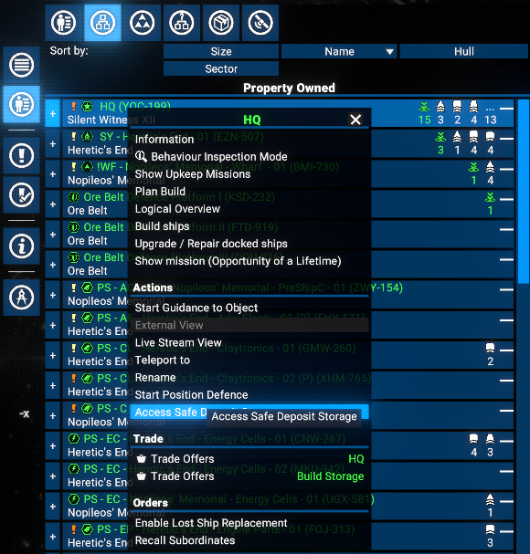

If the HQ is too far away, taking in account the Teleportation range, the context menu will be disabled, with respective hover tooltip.

#### Safe Deposit Storage via Station Manager Interaction

To get an access to the Safe Deposit Storage on Player's HQ, you should make several simple steps:

- Establish a communication with the Player's HQ Station Manager on `Crew` tab of the `Information` menu of the Player's HQ.
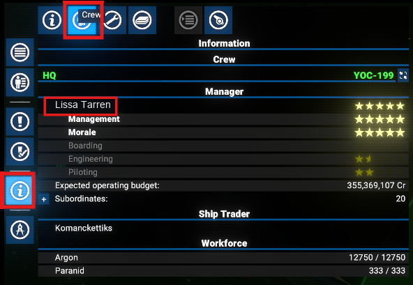
- There will be a new button `Access Safe Deposit Storage` in a top left corner of the interaction menu.
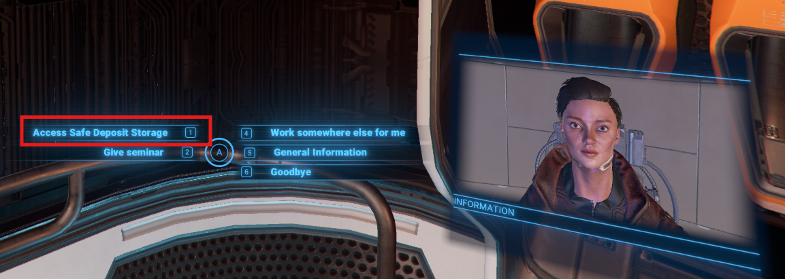
- Simple press it, and the standard Safe Deposit Storage Screen will be opened, allowing you to manage your Safe Deposit Storage as usual.
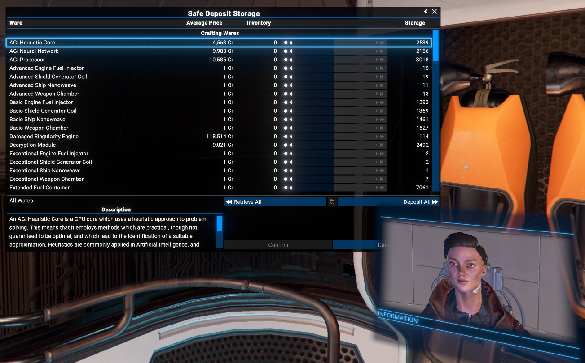

### Accessing the Pilot's Inventories

#### Pilot's Inventory via Context Menu

If you have installed any of the `X4 Mod Support APIs`, you can access the Pilot's Inventories via the context menu of the Pilot's ship - `Open the inventory menu`.

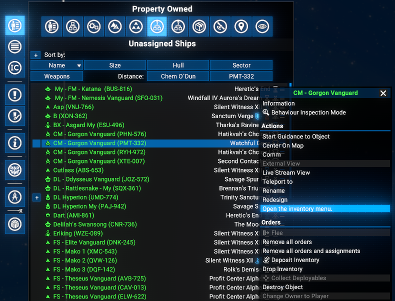

If the Pilot's Inventory is empty, the context menu will be disabled, with respective hover tooltip.

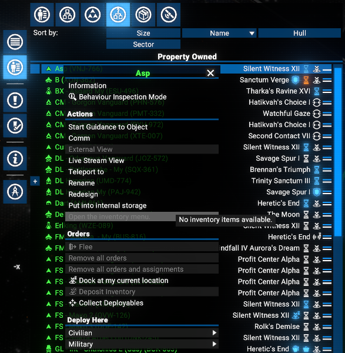

If the Pilot's Inventory too far away, taking in account the Teleportation range, the context menu will be disabled, with respective hover tooltip.

#### Pilot's Inventory via Pilot Communication

To get an access to the Pilot's Inventories, you should do next:

- Establish a communication with the Pilot directly via context menu of the appropriate ship or via the same `Crew` tab of the `Information` menu of the ship.
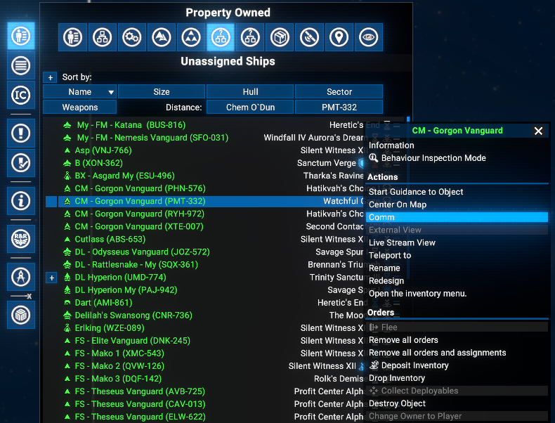
- For the Pilot's Inventory, there will be a new button `Open the inventory menu` in a top left corner of the interaction menu.
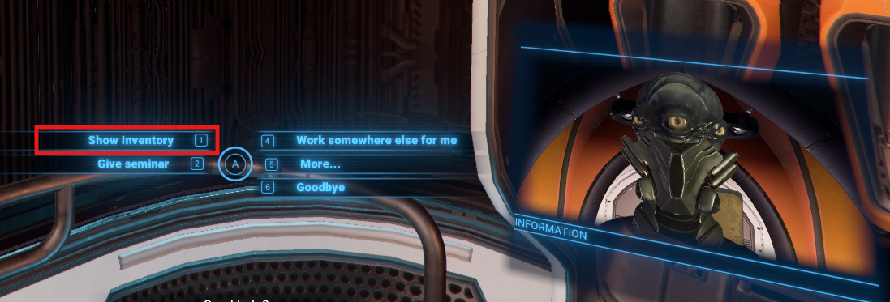
Important notice - you have not to be a pilot of any other ship, otherwise the Pilot's Inventory will not be available for you, as it's slot will be occupied by other command.

In addition there will be a change in interaction with a pilot/commander of the ship when you are on the same ship.

- Instead of the "standard" `Hand me inventory` command, there will be a new command `Inventory: More...` in the context menu of the pilot/commander.
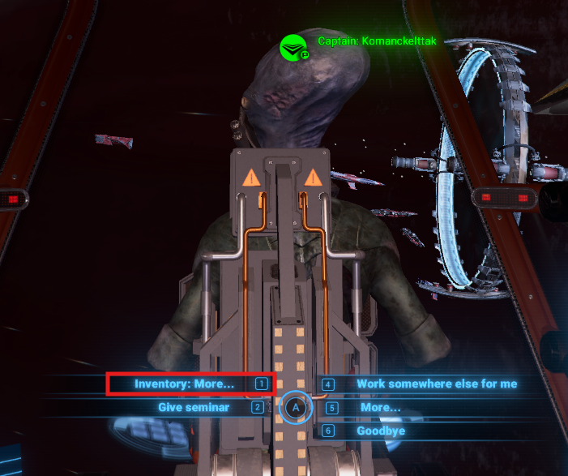

- Which will contain both `Hand me inventory` and `Open the inventory menu` commands inside.
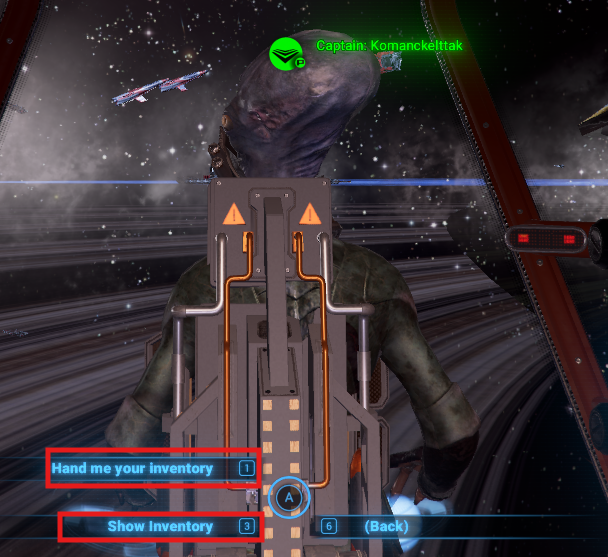

In both cases, the Pilot's Inventory will be opened in the same way as the Safe Deposit Storage, allowing you to manage it more granularly, then simply transferring items to the Player's inventory.
Important remark - the Title of the opened window will be the same as for the Safe Deposit Storage, but the content will be Pilot's Inventory.

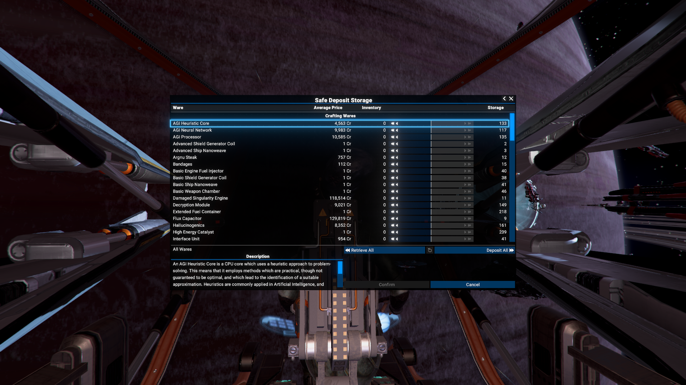

### Collecting all Pilot's Inventories

**Collect Pilot Inventories** moves every inventory item of your pilots into the Safe Deposit Storage of the HQ at once, without the ships flying there. It takes every ship of yours with a pilot other than you, docked ones included, whose sector is within Teleportation range of the HQ's sector: the same sector with the basic research, up to 2 gate jumps with Range I, up to 4 with Range II, any distance with Range III. Where you are does not matter.

- Via the context menu of the Player's HQ (needs any of the `X4 Mod Support APIs`).
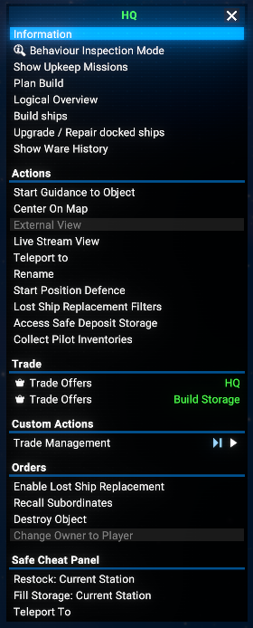
- Via the communication with the Player's HQ Station Manager, next to `Access Safe Deposit Storage`.
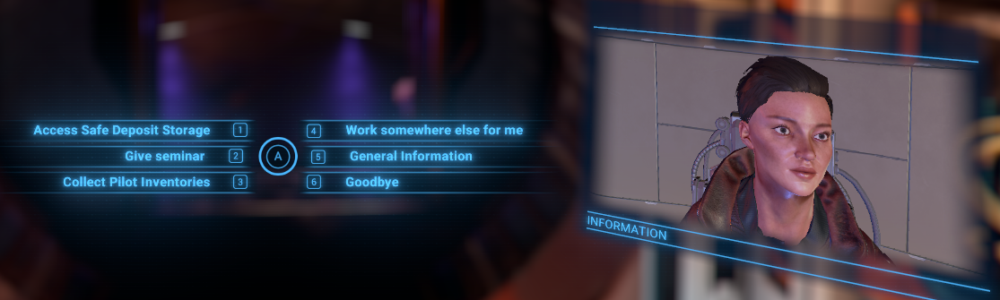

A short hint tells how many items were collected from how many pilots, or that there was nothing to collect.

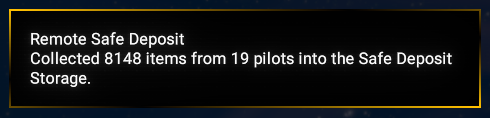

### Hotkeys

Needs the optional `Native Hotkey API`. Both hotkeys are off by default: switch **Safe Deposit Storage hotkey** and **Pilot's inventory hotkey** to `Enabled` in **Options Menu > Hotkey Management > Remote Safe Deposit**, then bind keys to the **Access Safe Deposit Storage** and **Open Pilot's Inventory** actions in **Options Menu > Hotkey Management > Hotkey Bindings**.

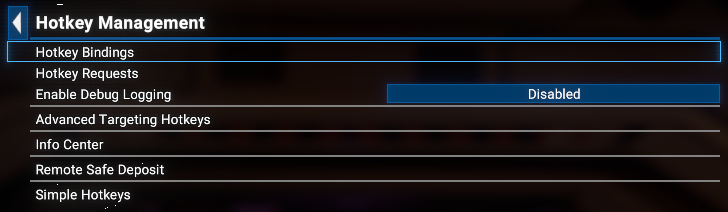

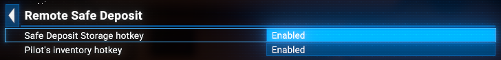

- **Access Safe Deposit Storage** - opens the Safe Deposit Storage of your headquarters, in flight, on foot or on the map.
- **Open Pilot's Inventory** - opens the inventory of the pilot of the selected ship: the ship selected on the map, your target in flight, or the ship or its pilot under the crosshair on foot. The ship must be yours and flown by a pilot other than you.
- Both follow the same Teleportation range as the context menu and the communication. When an action is not possible, a short hint says why, also on the map: no headquarters, no suitable ship selected, out of teleportation range, or no inventory items.
- The hotkeys do nothing while any other menu is open.

Switching a hotkey back to `Disabled` withdraws it and frees its hotkey slot and key for other mods.

### Extension Options

With the optional `Options Helper` installed, **Options Menu > Extension options > Remote Safe Deposit** has one setting:

- **Debug Level** - `None` by default. `Debug` records each access check in the game log, `Trace` adds the context menu detail. Needed only when reporting a problem. Without the `Options Helper` the debug output stays off.

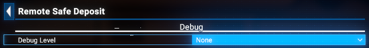

## Note if X4 Mod Support APIs is not installed

Please be aware that if the `X4 Mod Support APIs` is not installed, you can see small error messages in the debug log file, when it is enabled:

*Error in MD cue md.RemoteSafeDeposit.AddRemoteAccessActions: Evaluated value 'null' is not of type cue*.

The same message can appear for `md.RemoteSafeDeposit.Register_Menu`. This is not an error, but a warning that the context menu and the options page are not available. The mod will work as expected, but without them.

## Links

There is a thread on EgoSoft forum - [[Mod/MD] Remote Access to Safe Deposit Storage and Pilot's Inventories](https://forum.egosoft.com/viewtopic.php?t=471543)

### Videos

- There is a video with gameplay demonstration - [X4 Foundations - Remote Access to Safe Deposit Storage and Pilot's Inventories](https://www.youtube.com/watch?v=ajfj0C5JpwI) for versions prior to 1.02.

- There is a video with demonstration of the context menu support - [X4 Foundations - Remote Access to Safe Deposit Storage and Pilot's Inventories. With context menus](https://www.youtube.com/watch?v=7IDXfXtLi3Q) from version 1.02.
